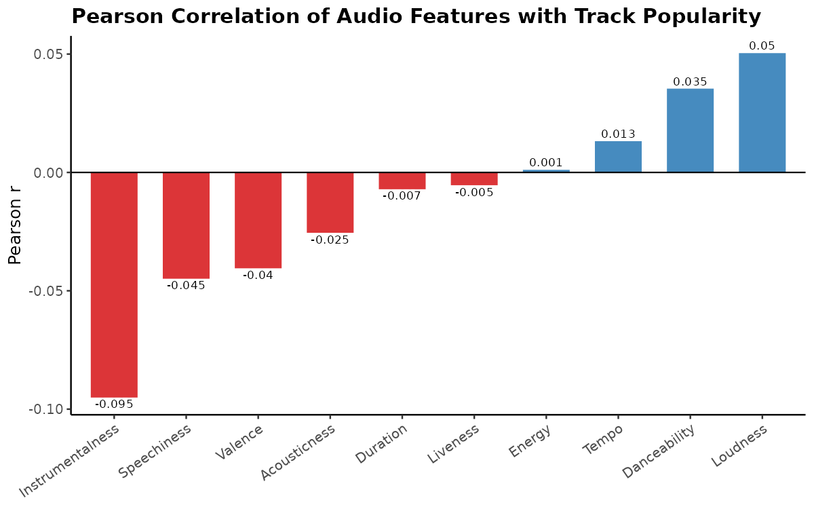
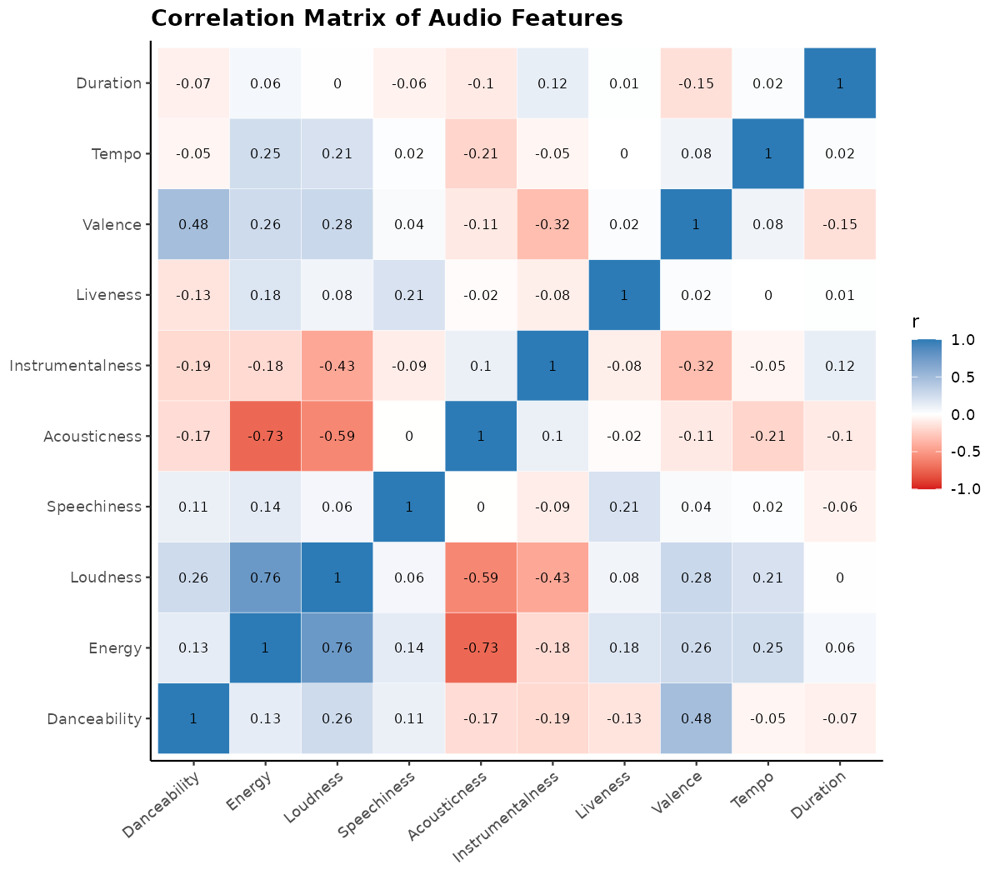
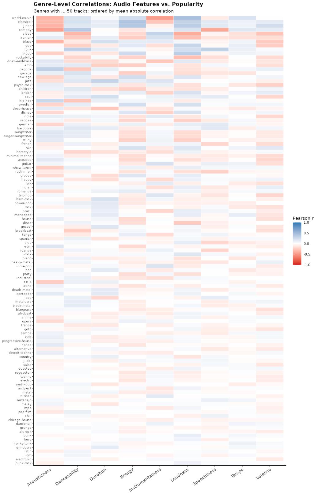
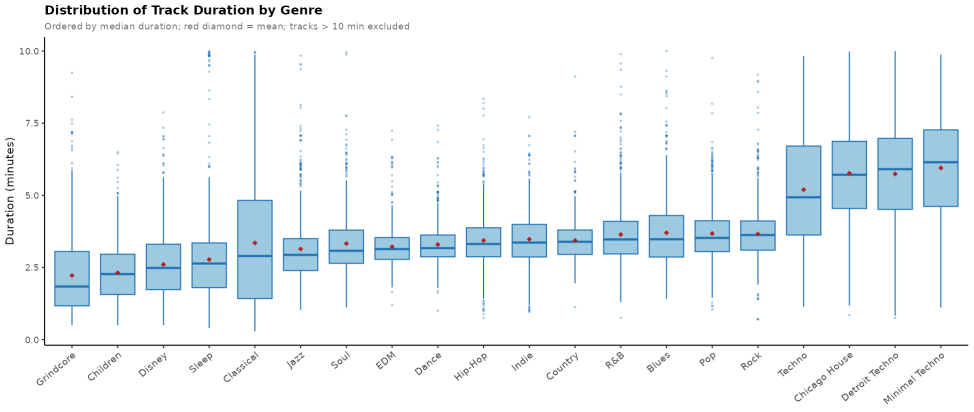
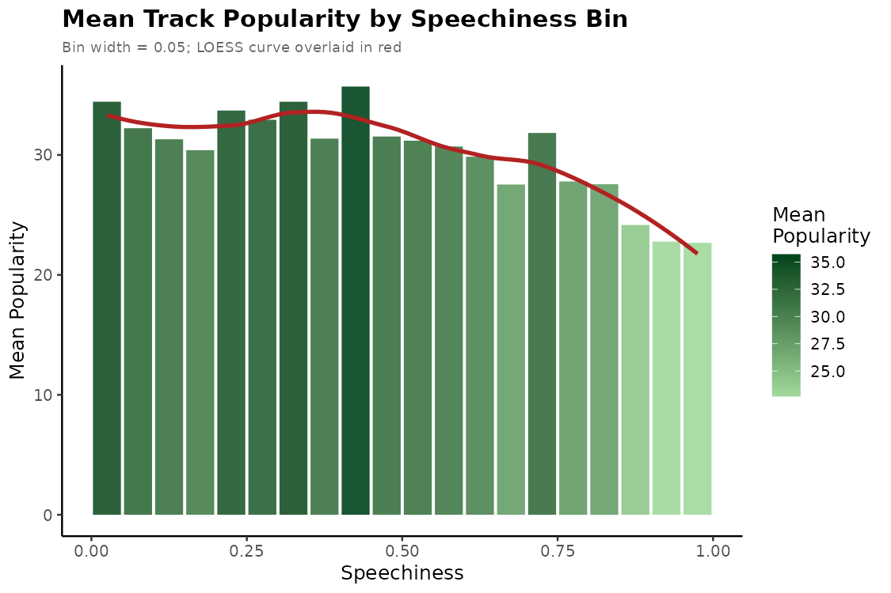

# What Makes a Song Popular?

**Spotify track statistical analysis | Georgia Tech ISYE 3030 | Spring 2026**

A team study of how Spotify audio features relate to track popularity across **113,999 observations and 114 genres**, using R, Pearson correlation, multiple linear regression, one-way ANOVA, and Welch two-sample t-tests.

**Main finding:** the multiple regression explained approximately **2.3% of popularity variation**. Statistical significance in a large dataset did not translate into strong predictive performance.

## Explore the project

- [Full final report, including the original R code appendix](docs/final-report.pdf)
- [Visual results](figures/)
- [Publication notes](PUBLICATION_NOTES.md)

## Results

Individual audio-feature correlations with popularity were weak. Genre-level comparisons showed that a feature's relationship with popularity can change across musical contexts. Track duration differed across genres, and the overall explicit-content popularity difference did not hold consistently within individual genres.

These are associations from an observational dataset. They do not establish that changing an audio feature causes a song to become popular.

### Audio features and popularity

### Relationships among audio features

### Genre-level variation

### Track duration by genre

### Speechiness and popularity

## Data and methods

The study used Maharshi Pandya's [Spotify Tracks Dataset on Kaggle](https://www.kaggle.com/datasets/maharshipandya/-spotify-tracks-dataset). The original dataset has 114,000 rows; the project removed one observation with a missing track name. Raw data is obtained separately from the upstream dataset and is not redistributed here.

The original analysis used R and compared ten numeric audio features with popularity. The report includes methods, model statistics, figures, limitations, references, and the R analysis code in its appendix. This initial portfolio snapshot contains the report and the original figures embedded in it; it does not include a standalone executable R script.

## Team

Elijah Ritchey, **Khush Desai**, Zhengyu Liu, and Andrew Kim.

This repository presents a collaborative course project. The report retains the team's original authorship credits and conclusions.
